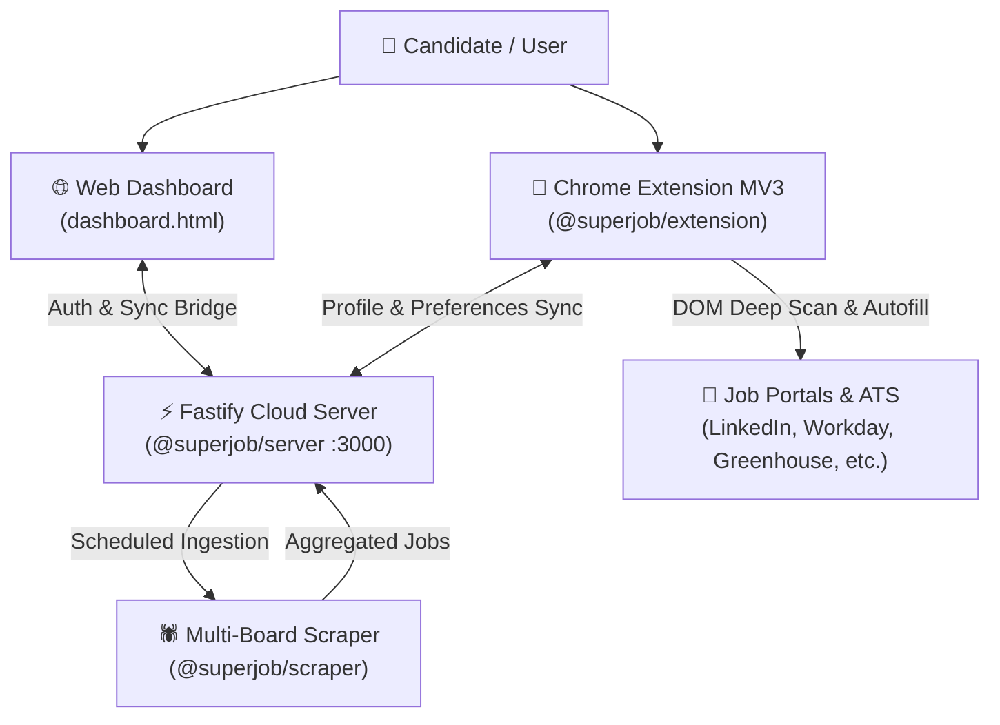

# SuperJobAgent (SJA)

> **Enterprise Agentic AI Job Application & Career Discovery Platform**  
> Unified Browser Extension (React Side-Panel), Fastify Cloud Backend, Dynamic Dashboard, and Multi-Board Scraper Engine.

---

## 🏛️ Architecture Overview

SuperJobAgent connects an interactive user workspace dashboard, an authenticated Fastify backend, and a Chrome Manifest V3 browser extension for automated, human-reviewed job applications across LinkedIn and major ATS platforms (Workday, Greenhouse, Lever, Ashby, BambooHR, ICIMS, Taleo, etc.).



---

## 📦 Monorepo Workspaces

The platform is structured as an npm monorepo with 10 modular workspaces under [`packages/`](packages/):

| Package | Workspace Name | Purpose |
| :--- | :--- | :--- |
| [`packages/core`](packages/core) | `@superjob/core` | Core data schemas, profile models, user settings, and sync envelopes. |
| [`packages/extension`](packages/extension) | `@superjob/extension` | Chrome MV3 Extension with React side-panel, autopilot engines, and DOM autofillers. |
| [`packages/server`](packages/server) | `@superjob/server` | Fastify backend API (JWT auth, LLM integration, rate limiting, WebSockets, tenant storage). |
| [`packages/scraper`](packages/scraper) | `@superjob/scraper` | Job scraper framework (Indeed, RemoteOK, Arbeitnow, company careers). |
| [`packages/ats-config`](packages/ats-config) | `@superjob/ats-config` | Autonomous ATS platform detection rules and field mapping chunks. |
| [`packages/applier`](packages/applier) | `@superjob/applier` | Headless & programmatic application runners. |
| [`packages/crew`](packages/crew) | `@superjob/crew` | Multi-agent orchestration crews for deep career analysis. |
| [`packages/mcp`](packages/mcp) | `@superjob/mcp` | Model Context Protocol integration for external AI clients. |
| [`packages/email-monitor`](packages/email-monitor) | `@superjob/email-monitor` | Application status tracking and confirmation email processing. |
| [`packages/analytics`](packages/analytics) | `@superjob/analytics` | Privacy-preserving telemetry and metrics logging. |

---

## 🚀 Quickstart Guide

### 1. Prerequisites
- **Node.js**: v18+ (v20+ recommended)
- **npm**: v9+
- **Google Chrome**: For running the Manifest V3 extension

### 2. Installation
From the repository root:
```bash
npm install
```

### 3. Running the Backend Server
```bash
npm run dev --workspace @superjob/server
```
The server starts on `http://localhost:3000` with live API and WebSocket support.

### 4. Running the Web Dashboard
Open `dashboard.html` in your browser (or visit `http://localhost:3000/dashboard.html` once the server is running).

### 5. Building the Chrome Extension
```bash
npm run build --workspace @superjob/extension
```
Or for interactive hot-reload development:
```bash
npm run dev --workspace @superjob/extension
```

To load the extension into Chrome:
1. Navigate to `chrome://extensions/`
2. Enable **Developer mode** (top-right switch).
3. Click **Load unpacked** and select `packages/extension/.output/chrome-mv3`.

---

## 🧪 Validation & Testing

Run workspace checks and automated test suites:
```bash
# Typecheck core and server
npm run typecheck --workspace @superjob/core
npm run typecheck --workspace @superjob/server

# Typecheck extension
npm run typecheck --workspace @superjob/extension

# Run core tests
npm run test --workspace @superjob/core

# Run real-world live tests
npx tsx scripts/test-all-ai-features.ts
```

---

## 📚 Master Architecture & Documentation

Comprehensive architectural dossiers and audits are available in the [`docs/`](docs/) directory:

- [`docs/SUPERJOBAGENT_10_PAGE_MASTER_SYSTEM_DOCUMENT.md`](docs/SUPERJOBAGENT_10_PAGE_MASTER_SYSTEM_DOCUMENT.md) — Complete 10-page master architecture guide.
- [`docs/SUPERJOBAGENT_100_PAGE_GRANULAR_CODE_AUDIT_AND_JOBRIGHT_BLUEPRINT.md`](docs/SUPERJOBAGENT_100_PAGE_GRANULAR_CODE_AUDIT_AND_JOBRIGHT_BLUEPRINT.md) — 100-page deep-dive code audit and competitor blueprint.
- [`docs/SUPER_JOB_AGENT_CTO_ENTERPRISE_ARCHITECTURAL_AUDIT.html`](docs/SUPER_JOB_AGENT_CTO_ENTERPRISE_ARCHITECTURAL_AUDIT.html) / [`.pdf`](docs/SUPER_JOB_AGENT_CTO_ENTERPRISE_ARCHITECTURAL_AUDIT.pdf) — CTO architectural audit report.
- [`docs/SuperJobAgent_Complete_Architecture_and_Interview_Mastery_Guide.pdf`](docs/SuperJobAgent_Complete_Architecture_and_Interview_Mastery_Guide.pdf) — Architectural and interview mastery guide.
- [`docs/LLM_HANDOFF_GUIDE.md`](docs/LLM_HANDOFF_GUIDE.md) — Developer and LLM pairing handoff guide.
- [`DEMO_GUIDE.md`](DEMO_GUIDE.md) — 3-minute interactive demonstration instructions.

---

## 📄 License & Ownership
Created and maintained by Shashi Kumar.
